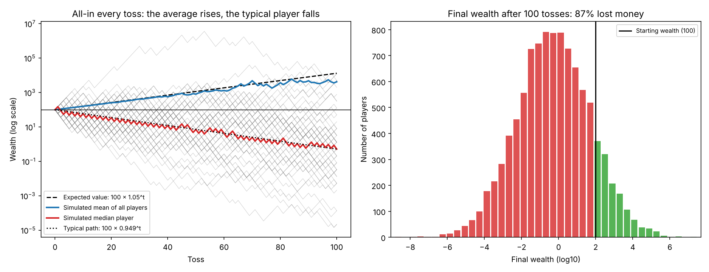

# All-in on a "good" coin

[](https://colab.research.google.com/github/Thienphuc-nd2206/kelly-coin-sim/blob/main/all_in_coin.ipynb)

A fair coin pays **+50%** on heads and **−40%** on tails. The expected return per toss is **+5%**, yet a player who bets everything on every toss almost always loses money. This repository simulates 10,000 such players over 100 tosses.



## Key result

| | Value |
|---|---|
| Expected wealth after 100 tosses (start = 100) | 13,150 |
| Median wealth after 100 tosses | 0.52 |
| Share of players who lose money | about 86% |

The expected (arithmetic) return is +5% per toss, but the typical (geometric) return is √(1.5 × 0.6) − 1 ≈ −5.1% per toss. A single player lives through time, not across the ensemble, so the geometric return is what matters. This is the motivation for the Kelly criterion: bet a fraction of wealth rather than all of it.

## Files

| File | What it is |
|---|---|
| `all_in_coin.ipynb` | Notebook version, runs in Google Colab |
| `all_in_coin.py` | Python script |
| `all_in_coin.m` | MATLAB script, same logic |
| `all_in_coin.png` | Output chart |

## How to run

**In the browser:** click the *Open in Colab* badge above, then *Runtime → Run all*.

**On your computer (Python):**

```bash
pip install -r requirements.txt
python all_in_coin.py
```

**MATLAB:** open `all_in_coin.m` and press *Run* (base MATLAB, R2016b or later).
